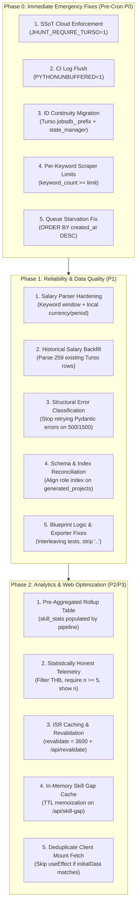

# JHunt: Architectural Remediation Plan (2026-10-12)

**Based on:** [`docs/audits/2026-10-12-architecture-reflection.md`](file:///C:/Users/MRmar/Desktop/Mid%20years%20projects/JHunt/docs/audits/2026-10-12-architecture-reflection.md)  
**Target:** Eliminate data loss vectors, prevent duplicate re-alert storms, restore scraper coverage, fix salary parsing precision, and optimize Turso telemetry.

---

## Executive Phasing Overview



---

## Phase 0: Immediate Emergency & Data Integrity Fixes (P0)

> [!IMPORTANT]
> Must be executed before the scheduled 01:00 UTC daily cron runs to prevent duplicate Telegram alerts and data fragmentation.

### Task 0.1: ID Continuity Migration & State Compatibility
- **Problem**: Commit `859240d` introduced the `jobsdb_{id}` prefix for JobsDB listings, whereas existing Turso rows (259 items) and `data/seen_jobs.json` contain bare numeric IDs (`95178481`). Without migration, incoming JobsDB jobs will be classified as unseen, triggering duplicate Telegram alerts and redundant Turso insertions.
- **Action Items**:
  1. **Run One-Time SQL Migration in Turso**:
     ```sql
     UPDATE skills_extracted SET job_id = 'jobsdb_' || job_id WHERE job_id GLOB '[0-9]*';
     UPDATE jobs SET id = 'jobsdb_' || id, source = 'jobsdb' WHERE id GLOB '[0-9]*';
     ```
  2. **Update `state_manager.py`**:
     In `StateManager._load`, automatically map bare numeric IDs to `jobsdb_` on load:
     ```python
     if isinstance(seen, dict):
         return {(f"jobsdb_{k}" if str(k).isdigit() else str(k)): v for k, v in seen.items()}
     ```
  3. **Clean Any Partial Pre-Migration Duplicates**:
     Delete any prefixed duplicates already inserted where the numeric ID existed.

### Task 0.2: Enforce Turso as Single Source of Truth in CI
- **Problem**: `get_storage()` silently falls back to local SQLite when Turso initialization fails. In CI, runner SQLite is ephemeral and discarded on container termination, resulting in silent data loss while the workflow reports green.
- **Action Items**:
  1. **Modify `src/storage/__init__.py`**:
     Add `require_cloud: Optional[bool] = None` to `get_storage()`.
     If `require_cloud` is True or `JHUNT_REQUIRE_TURSO=1` is set in the environment, raise a `RuntimeError` immediately if Turso fails or credentials are unset.
  2. **Add Unit Test in `tests/test_storage.py`**:
     Assert that `get_storage(require_cloud=True)` raises `RuntimeError` when `TURSO_DATABASE_URL` is omitted.
  3. **Update `.github/workflows/scraper_cron.yml`**:
     Inject `JHUNT_REQUIRE_TURSO: "1"` into the pipeline execution step.

### Task 0.3: Restore CI Log Observability
- **Problem**: All standard `print()` output is buffered and lost when the process exits or encounters unhandled termination in GitHub Actions.
- **Action Items**:
  1. Add `PYTHONUNBUFFERED: "1"` to `.github/workflows/scraper_cron.yml` under `env` for the pipeline execution step.

### Task 0.4: Restore Scraper Keyword Coverage
- **Problem**: In `JobsDBScraper.scrape()` (and Blognone/JobThai), `limit=50` breaks the loop when total accumulated jobs exceed 50. The first search keyword (`python developer`) yields 50+ results on page 1, causing the loop to exit and completely skipping subsequent keywords (`data engineer`, `backend engineer`).
- **Action Items**:
  1. Change loop condition to track `keyword_count >= limit` rather than `len(jobs) >= limit`.
  2. Configure per-adapter limits in `main.py`:
     - JobsDB: 150 per keyword (fast API query, no detail page fetch).
     - Blognone: 30 per keyword (SSR HTML).
     - JobThai: 30 per keyword (GraphQL).
  3. Add `time.sleep(self.REQUEST_DELAY)` before detail page fetches in Blognone and JobThai. Skip detail fetches for jobs already present in storage or state cache.

### Task 0.5: Prevent Ingestion Queue Starvation
- **Problem**: `get_unprocessed_jobs()` uses `ORDER BY j.created_at ASC`. If an early batch fails extraction (e.g. safety filters, malformed payload), it is perpetually selected at the front of the queue, starving newly scraped jobs from ever being extracted.
- **Action Items**:
  1. Change query in `src/storage/turso_client.py` and `src/storage/db.py` to `ORDER BY j.created_at DESC`.
  2. Add `extract_attempts INTEGER DEFAULT 0` column to `jobs` and filter `WHERE extract_attempts < 3` to bypass poison records.

---

## Phase 1: Reliability, Data Quality & LLM Pipeline (P1)

### Task 1.1: Salary Parser Precision & Noise Rejection
- **Problem**: Fuzzing revealed 6 misparse categories in `parse_salary()` when falling back to full job descriptions:
  - Global `_detect_period`: A single mention of "OT 200/hr" marked the entire job as hourly (`*160`).
  - Global `_detect_currency`: A single "$" mention (e.g. "Serving US clients") relabeled THB salaries to USD.
  - Candidate counts: "50,000+ merchants" or "20,000 engineers" matched as lower bounds.
  - Annual bonuses: "Bonus up to 120,000 annually" matched as monthly max salary.
- **Action Items**:
  1. **Anchor Description Search**:
     Only scan description text within a sliding window (150 characters) following explicit salary keywords:
     `r"(?i)(?:salary|เงินเดือน|ค่าตอบแทน|compensation|remuneration|รายได้|ค่าจ้าง)\s*[:\s]"`
  2. **Localize Currency & Frequency Detection**:
     Detect period and currency strictly within the matched salary substring, not globally across the entire 2000-character job description.
  3. **Disallow Count Suffixes**:
     Do not match numbers followed by non-currency nouns (e.g. `merchants`, `users`, `people`, `คน`, `ร้านค้า`).
  4. **Expand Hermetic Tests in `tests/test_salary_parser.py`**:
     Add test cases for all 6 failing edge cases identified in the audit.

### Task 1.2: One-Time Historical Salary Backfill
- **Problem**: Only 3 of 259 rows in Turso currently have parsed salaries because existing rows were never backfilled after adding salary columns.
- **Action Items**:
  1. Write a script `scripts/backfill_salaries.py` that queries jobs with `min_salary IS NULL AND salary IS NOT NULL`.
  2. Parse `salary` using `parse_salary()` and batch-update `min_salary`, `max_salary`, `currency` in Turso.

### Task 1.3: Fix Transient Error Misclassification in Gemini Client
- **Problem**: `is_transient_error()` in `src/extractor/gemini_client.py` matches substrings `"500"` or `"502"` anywhere in the error message. Pydantic validation errors (`ValidationError`) include the input text which frequently contains numbers like `1500` or `25,000`, causing deterministic schema failures to be retried 4 times.
- **Action Items**:
  1. Do not catch Pydantic `ValidationError` inside the retry loop; catch schema errors separately as non-transient.
  2. Inspect HTTP status codes structurally (`getattr(e, "code", None)` or regex match on status code header) rather than loose substring search on `str(e)`.
  3. Add an overall wall-clock deadline to `_generate` to prevent exceeding GitHub Actions execution limits.

### Task 1.4: Schema & Index Reconciliation
- **Problem**: `schema.py` defines `idx_projects_role ON generated_projects(target_role)`, but Turso's live table has no `target_role` column, causing index creation failures in CI.
- **Action Items**:
  1. Update `schema.py` to create `idx_projects_role ON generated_projects(role)` instead of `target_role`.
  2. Drop obsolete unused indexes: `idx_jobs_posted_at`, `idx_jobs_source`, `idx_skills_experience`.
  3. Enclose all DDL statements in `TursoClient.init_schema()` in defensive blocks so index errors never abort startup.

### Task 1.5: Blueprint Specification & Exporter Polish
- **Problem**: Blueprint #16 contains logic contradictions (e.g. 422 for retryable webhooks, rollback before status write, `pytest-xdist` for in-test concurrency) and formatting glitches (`..` and `1. Step 1:`).
- **Action Items**:
  1. Update `src/generator/ideation_engine.py` prompt constraints:
     - Require webhook retry codes to be 5xx / 409, never 422.
     - Specify that status updates must commit in an autonomous transaction before main rollback.
     - Require `asyncio.gather` with `httpx.AsyncClient` for concurrency assertions.
  2. Update `src/generator/markdown_exporter.py` to strip double periods and deduplicate step prefixes.
  3. Update `canonicalizeSkill` in `web/src/lib/turso.ts` to map versioned tech strings (`Python 3.12` -> `Python`, `PostgreSQL 16` -> `PostgreSQL`).

---

## Phase 2: Analytics Rollup & Web Optimization (P2 / P3)

### Task 2.1: Pre-Aggregated Rollup Table (`skill_stats`)
- **Problem**: Next.js `/analytics` currently executes 4 to 7 raw queries on every visit, including full scans of `skills_extracted`, computing co-occurrences in serverless memory.
- **Action Items**:
  1. Add table `skill_stats` to `src/storage/schema.py`:
     ```sql
     CREATE TABLE IF NOT EXISTS skill_stats (
         skill TEXT PRIMARY KEY,
         category TEXT,
         job_count INTEGER NOT NULL,
         salary_count INTEGER DEFAULT 0,
         avg_salary_thb INTEGER,
         updated_at TIMESTAMP DEFAULT CURRENT_TIMESTAMP
     );
     ```
  2. In `main.py`, compute and populate `skill_stats` in a single transaction at the end of the pipeline run.
  3. In `web/src/lib/turso.ts`, read directly from `skill_stats` instead of full table scans.

### Task 2.2: Statistically Honest Telemetry
- **Problem**: The dashboard currently shows "Top Compensated Skills" based on an intersection of 0–3 jobs, mixes currencies, and hides sample size $n$.
- **Action Items**:
  1. Enforce `currency = 'THB'` on all salary aggregation queries.
  2. Require sample size $n \ge 5$ before displaying salary benchmarks.
  3. Display sample size badge (e.g. `(n=18 jobs)`) alongside all salary figures.
  4. In `SkillGapMatcher.tsx`, remove artificial `Math.max(1, ...)` floor when unlock potential is 0.

### Task 2.3: ISR Caching & On-Demand Revalidation
- **Problem**: `/` and `/analytics` use `force-dynamic`, executing live queries on every request. Data only changes once per day during the pipeline run.
- **Action Items**:
  1. Replace `force-dynamic` with `export const revalidate = 3600;` on `/` and `/analytics`.
  2. Implement `web/src/app/api/revalidate/route.ts` checking an `x-revalidate-token` header.
  3. In `.github/workflows/scraper_cron.yml`, call the revalidate endpoint as the final step.

### Task 2.4: Eliminate Duplicate Client Mount Query
- **Problem**: `SkillGapMatcher` receives server-rendered `initialData`, but its `useEffect` immediately fires on mount with default skills, triggering 3 duplicate queries to `/api/skill-gap`.
- **Action Items**:
  1. In `SkillGapMatcher.tsx`, skip the initial `fetch()` if `selectedSkills` matches `initialData.userSkills`.
  2. In `web/src/app/api/skill-gap/route.ts`, memoize the in-memory skill map with a 10-minute TTL.

---

## Execution Schedule & Verification Checkpoints

| Phase | Milestone | Success Verification Criteria |
| :--- | :--- | :--- |
| **Phase 0** | **Emergency SSoT & ID Migration** | 1. `get_storage(require_cloud=True)` raises if URL missing.<br/>2. Turso IDs have `jobsdb_` prefix.<br/>3. CI workflow runs with `JHUNT_REQUIRE_TURSO=1` and `PYTHONUNBUFFERED=1`.<br/>4. All 128 tests pass. |
| **Phase 1** | **Extraction & Parser Hardening** | 1. 15 realistic salary test cases pass without misparses.<br/>2. Historical 259 Turso rows backfilled.<br/>3. Non-transient Pydantic errors abort without 4 retries.<br/>4. Turso startup executes 0 failing index statements. |
| **Phase 2** | **Analytics Rollup & ISR Caching** | 1. `skill_stats` populated on pipeline completion.<br/>2. `/analytics` renders from cache with 0 live Turso row reads.<br/>3. Sample size $n$ displayed on all compensation cards. |
